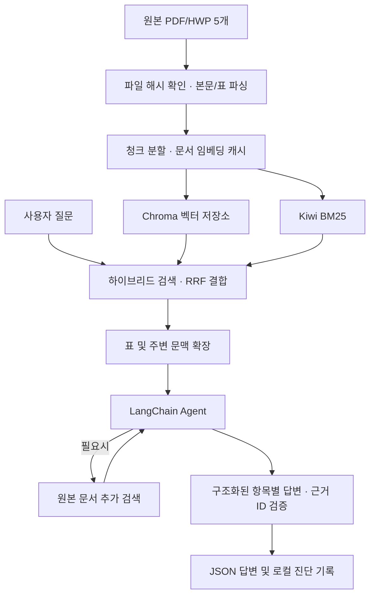

# 가천대학교 입학 안내 Agentic RAG 챗봇

2027학년도 가천대학교 입학 관련 **원본 5개 문서**에서 근거를 검색하고 질문에 답하는 수업 프로젝트입니다. PDF 4개와 HWP 1개를 파싱하고, **Chroma 벡터 검색 + Kiwi BM25 키워드 검색**을 결합합니다. LangChain Agent는 필요한 근거가 부족하면 문서를 추가 검색합니다.

가천대학교의 공식 상담 서비스가 아닌 학습용 구현입니다. 답변의 사실 근거는 저장소에 포함된 5개 문서로 제한하며, 웹 검색이나 추가 문서 수집 도구를 사용하지 않습니다.

## 구성

```text
gachon-admission-rag/
├── 202235088_이윤형.ipynb     # 실행할 노트북
├── requirements.txt
├── .gitignore
└── data/gachon_midterm/
    ├── 01_2027학년도_재외국민_모집요강.hwp
    ├── 02_2027학년도_지역의사선발전형_안내.pdf
    ├── 03_2027학년도_수시_모집요강.pdf
    ├── 04_2027학년도_정시_모집요강.pdf
    ├── 05_2027학년도_수시_면접고사_일정.pdf
    └── manifest.json        # 문서별 크기와 SHA-256
```

## 처리 흐름



- **문서 파싱:** PDF 본문·표, HWP 문단을 추출하고 출처와 위치 정보를 보존합니다.
- **청크:** 크기 1,100자, 중복 200자를 사용합니다.
- **검색:** 벡터 유사도와 키워드 검색 결과를 RRF로 결합하고 관련 부모 문맥을 확장합니다.
- **Agent:** 질문별 최초 검색 후, 추가 검색은 최대 1회이며 검색어는 최대 2개입니다.
- **답변:** 질문을 필수 항목으로 나누어 답과 근거 ID를 생성합니다. 미확인 항목은 추측하지 않고 표시합니다.
- **검증:** 사용한 근거 ID가 실제 전달한 문서에 포함되는지 확인합니다. 이 검사가 답변의 의미적 정확성을 보장하는 것은 아닙니다.

## 모델 및 환경

| 항목 | 노트북 설정 |
| --- | --- |
| 답변 모델 | `gpt-5.4-mini` |
| 추론 강도 | `none` |
| 임베딩 모델 | `text-embedding-3-small` |
| 벡터 저장소 | Chroma, cosine |
| 키워드 검색 | Kiwi 형태소 분석 + BM25 |
| 실행 환경 | Python 3.12 / Google Colab 또는 Jupyter |

패키지 버전은 제출 노트북의 설치 셀을 기준으로 `requirements.txt`에 정리했습니다. 실제 모델 사용에는 해당 모델을 사용할 수 있는 OpenAI API 계정이 필요합니다.

## 로컬 실행

저장소를 내려받아 최상위 폴더로 이동합니다.

```bash
git clone https://github.com/lyh30107-ai/gachon-admission-rag.git
cd gachon-admission-rag
python -m venv .venv
```

Windows PowerShell에서 다음 명령을 실행합니다. 가상환경 활성화 없이도 실행할 수 있습니다.

```powershell
.\.venv\Scripts\python.exe -m pip install -r requirements.txt
$env:OPENAI_API_KEY = "본인의 실제 API 키"
.\.venv\Scripts\python.exe -m jupyterlab
```

노트북을 열고 셀을 위에서부터 실행합니다. 마지막 셀에서 질문을 입력하고, 대화를 끝낼 때는 `종료`를 입력합니다. API 키는 환경변수로만 설정하고 노트북이나 저장소에 저장하지 마세요.

macOS/Linux에서는 `.venv/bin/python`으로 설치·실행하고 `export OPENAI_API_KEY="..."`로 환경변수를 설정할 수 있습니다.

## Google Colab 실행

1. 이 저장소의 노트북을 Colab에서 엽니다.
2. 왼쪽 **Secrets(열쇠 아이콘)**에 `OPENAI_API_KEY`를 추가하고 노트북 접근을 허용합니다.
3. 노트북 맨 위에 다음 셀을 추가해 저장소의 데이터 파일을 준비합니다. 새 Colab 런타임에서 한 번 실행합니다.

```python
!git clone https://github.com/lyh30107-ai/gachon-admission-rag.git /content/gachon-admission-rag
%cd /content/gachon-admission-rag
```

4. 기존 설치 셀부터 차례대로 실행합니다.

위 clone은 제공된 프로젝트와 데이터 파일을 실행 환경에 준비하기 위한 단계입니다. 질문에 답하는 검색 과정에서는 외부 사이트를 조회하지 않습니다. 원본 파일 5개를 `/content`에 직접 업로드해도 경로 셀이 이를 인식합니다.

## 결과와 기록

질문마다 다음 형태의 JSON 배열을 출력합니다. 아래 문자열은 출력 형식 설명용이며 정답 데이터가 아닙니다.

```json
[
  {
    "question": "사용자가 입력한 질문",
    "sample answer": "검색된 문서 근거로 생성한 답변"
  }
]
```

- `answers.json`: 현재 대화의 질문과 답변
- `run_metrics.json`: 처리 시간, 검색 횟수, 근거, 미확인 항목 등의 진단 정보
- `.gachon_rag/`: 문서 파싱 결과, 임베딩 캐시 및 Chroma 데이터

위 파일들은 실행 환경에 생성되며 `.gitignore`로 Git 업로드에서 제외합니다. API 키, 가상환경, 노트북 체크포인트도 제외합니다. 이미 실행한 노트북을 다시 커밋할 때는 출력에 키나 개인 질문이 남아 있지 않은지 확인하세요.

## 데이터 출처와 범위

수업에서 제공받은 `dataset.zip`의 원본 5개 파일입니다. 모든 파일은 기존 제출 코드에 등록된 SHA-256과 일치하며, 변환하거나 다른 문서로 교체하지 않았습니다. `data/gachon_midterm/manifest.json`에서 해시를 확인할 수 있습니다.

문서의 저작권은 해당 권리자에게 있으며, 이 저장소는 문서에 별도의 오픈소스 라이선스를 부여하지 않습니다. 수업 평가 안내 PDF, 평가용 정답집, 추가 검색 문서는 포함하지 않습니다.

## 평가 목표와 현재 확인 범위

수업 평가 기준은 50개 문항의 정확성 80점, 응답 시간 20점이며, 질문별 5초 이내 응답을 목표로 합니다. 이 수치는 프로젝트 목표이지 측정된 성적이나 보장된 응답 시간이 아닙니다.

GitHub 업로드 준비 과정에서는 노트북 문법, 원본 파일 해시, 설정 셀과 업로드 제외 항목을 검사합니다. 유료 API를 호출한 전체 실행이나 50개 문항의 정확도·속도 측정은 이번 게시 과정에서 수행하지 않았습니다.

## 제출본과의 차이

기존 검색·Agent·답변 생성 로직과 모델 설정은 유지했습니다. 게시용 사본에서는 다음만 변경했습니다.

1. API 키를 코드에 직접 저장하는 대신 환경변수 또는 Colab Secrets에서 읽도록 변경
2. 개인 환경의 고정 경로 대신 저장소 내 상대 경로 사용 (`/content` 직접 업로드도 지원)
3. 기존 실행 출력과 실행 횟수 제거

바탕화면의 제출 원본 노트북은 변경하지 않았습니다.
